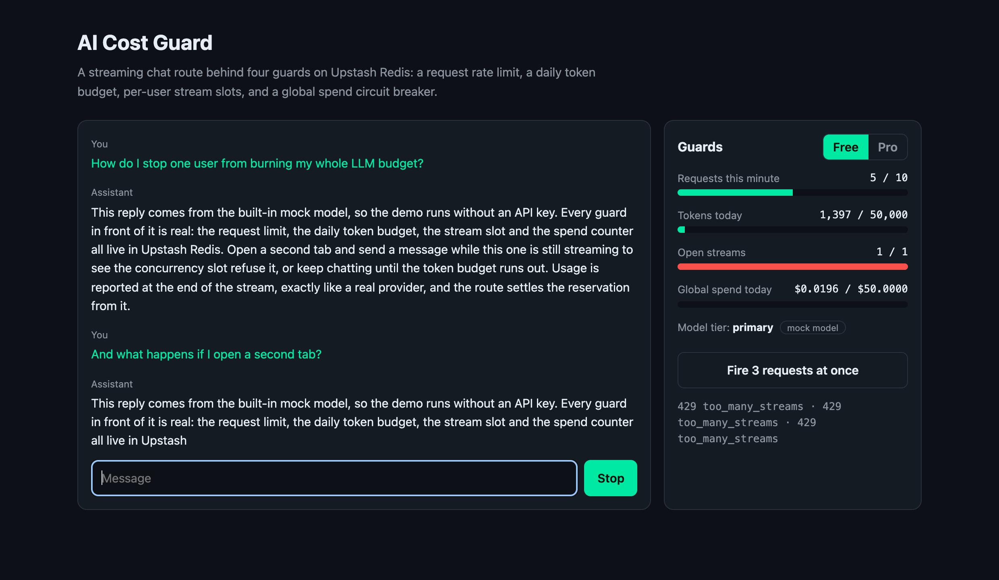

# nextjs-ai-cost-guard

A streaming AI chat route in Next.js 16, guarded so that no single user, and no bad day, can run up your model bill. Four guards, all on [Upstash Redis](https://upstash.com/docs/redis/overall/getstarted?utm_source=ahmed-mahmoud):

| Guard | What it stops | How |
| --- | --- | --- |
| Request rate limit | Bursts and scripted floods | [`@upstash/ratelimit`](https://upstash.com/docs/redis/sdks/ratelimit-ts/overview?utm_source=ahmed-mahmoud) sliding window per user |
| Daily token budget | One user spending a month of tokens in an afternoon | Reserve `input estimate + maxOutputTokens` before the call, settle to the real usage after |
| Stream slots | Ten tabs streaming ten long answers at once | A sorted set of open leases per user, with a TTL for functions that die mid-stream |
| Spend circuit breaker | Many users each inside their budget, together far outside yours | A global daily spend counter: fallback model past the soft cap, 503 past the hard cap |

Layers two to four run as one Lua script, so admission is one Redis round trip and either takes everything or changes nothing.

**Live demo:** [ai-cost-guard.devya.dev](https://ai-cost-guard.devya.dev) (mock model, real guards, Cloudflare Workers + Upstash Redis). Open it in two tabs and send a message in both, or press *Fire 3 requests at once*.

Written for the article *Building Production-Ready AI Apps with Next.js and Upstash Redis: Rate Limiting, Cost Control, and Scalability* by [Ahmed Mahmoud](https://www.eng-ahmed.com).



## Run it

```bash
pnpm install
cp .env.example .env.local   # add your Upstash REST URL and token
pnpm dev
```

No model key is needed. Without `AI_GATEWAY_API_KEY` the route uses a built-in mock model that streams a canned answer and reports token usage like a real provider, so every guard is exercised for real. Set the key to use `PRIMARY_MODEL` and `FALLBACK_MODEL` through the Vercel AI Gateway.

Get a free database from the [Upstash console](https://console.upstash.com/?utm_source=ahmed-mahmoud), or run Redis locally behind an Upstash-compatible REST endpoint ([SRH](https://upstash.com/docs/redis/sdks/ts/developing?utm_source=ahmed-mahmoud)):

```bash
docker compose up -d
UPSTASH_REDIS_REST_URL=http://localhost:8079 UPSTASH_REDIS_REST_TOKEN=local_token pnpm dev
```

## Deploy

- **Vercel:** import the repo, add `UPSTASH_REDIS_REST_URL` and `UPSTASH_REDIS_REST_TOKEN` (or install the Upstash integration). `vercel.json` already enables `supportsCancellation` on the chat route.
- **Cloudflare Workers** (how the live demo runs): `pnpm cf:deploy` builds with [OpenNext](https://opennext.js.org/cloudflare) and deploys `wrangler.jsonc`. Set the two secrets with `wrangler secret put`. The `enable_request_signal` compatibility flag is what makes a client disconnect reach `req.signal`, so aborts stop the model call.

## Where things are

```
app/api/chat/route.ts    admit → streamText → settle from onEnd / onAbort / onError
lib/guard/index.ts       admitChat(): rate limit, then the admit script; the Lease and its settle()
lib/guard/scripts.ts     the two Lua scripts (admit, settle)
lib/config.ts            plans, model tiers and prices, spend caps, slot TTL
lib/estimate.ts          input-token estimate and history trimming
lib/model.ts             AI Gateway model or the mock
```

## Tests

```bash
pnpm test     # integration tests against the Redis in .env.local (own key prefix per run)
pnpm smoke    # end-to-end against a running server: BASE_URL=http://localhost:3000 pnpm smoke
pnpm ci       # install, typecheck, test, build
```

`test/ratelimit-behaviour.test.ts` pins down library behaviour the design depends on, so an upgrade that changes it fails loudly:

- On a **slow** Redis, `@upstash/ratelimit` fails open: `success: true`, `reason: "timeout"`. On a **refused** connection it throws. The guard treats both as "fail closed" for this route.
- With `limit(id, { rate: n })`, `fixedWindow` and `slidingWindow` count a refused request's units, so one oversized request empties the window. `tokenBucket` refuses without consuming.

`test/stream-callbacks.test.ts` pins down AI SDK 7: a mid-stream provider error fires `onError` **and then** `onEnd`, which is why `settle()` runs exactly once.

## Policies worth knowing before you copy this

- **Abort charges the full reservation.** The partial step's usage is unknown on abort; the reservation is the only number that is never too low.
- **Provider errors are refunded.** Most happen before generation starts; billing users for an upstream outage is worse than under-counting a little.
- **A crashed function over-counts.** Its slot expires after `SLOT_TTL_MS`; its reservation stays charged.
- **The spend breaker checks committed spend only.** In-flight requests can overshoot the hard cap by at most `open streams × one request's cost`.
- On Vercel, `vercel.json` enables `supportsCancellation` for the chat route so a client abort actually cancels the function and the model call.

## License

MIT
